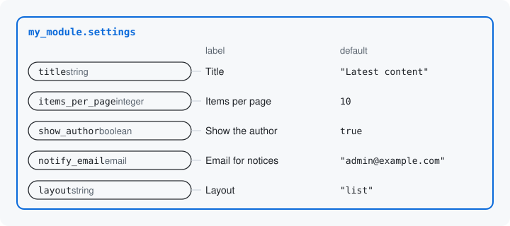

# Keys

A key is one value a resource or a structure holds. Each key has a
name, a type, a label and, where it needs one, a default. You declare a
key by adding it with `add()` in the resource class's static
`defineInputs()` method, with a schema that says the rest.



## Declaring keys

Your module's settings have five keys, one of each basic type. This is
`MySettingsResource`'s `defineInputs()` method, which declares them:

```php
public static function defineInputs(BlueprintInterface $inputs): void {
  $inputs->add('title', Schema::string()
    ->title(t('Title'))
    ->default('Latest content')
    ->maxLength(64)
    ->required());

  $inputs->add('items_per_page', Schema::integer()
    ->title(t('Items per page'))
    ->default(10)
    ->minimum(1)
    ->maximum(50)
    ->required());

  $inputs->add('show_author', Schema::bool()
    ->title(t('Show the author'))
    ->default(TRUE));

  $inputs->add('notify_email', Schema::string()->format('email')
    ->title(t('Email for notices'))
    ->default('admin@example.com'));

  $inputs->add('layout', Schema::options([
    'list' => t('List'),
    'grid' => t('Grid'),
  ])
    ->title(t('Layout'))
    ->default('list')
    ->required());
}
```

`defineInputs()` receives `$inputs`, a `BlueprintInterface`: the object
the class adds its keys to. The method and the object are named for
inputs, the values a caller sends; each input is a key. Some calls
on a key's schema, such as `required()`, `maxLength()` and
`minimum()`, say what the key allows: the next page's idea.

A class may instead write each key as a property of its own, with an
attribute saying what `add()` would say
([Declared as properties](../declaring-a-resource.md#declared-as-properties));
these pages use `defineInputs()` throughout.

## The four parts of a key

`add()` takes the key's name and its schema. The schema gives the
other three parts:

- **Name**: what the value is sent and read under, `items_per_page`.
- **Type**: the schema's first call. `Schema::string()`,
  `Schema::integer()`, `Schema::number()` and `Schema::bool()` are the
  basic types; `format('email')` or `format('uri')` on a string says
  more; `Schema::options()` is a list of values with their labels; and
  `Schema::of(HexColor::class)` starts from a shape, as on
  [Shapes](04-shapes.md). A value sent as the text `"20"` to the
  integer key `items_per_page` is accepted as the integer `20`.
- **Label**: `title()`, the form element's title, the tool's property
  title and the JSON Schema's `title`, one text for all three. Write it
  with `t()`.
- **Default**: `default()`, what the key starts from when nothing is
  saved for it.

`description()` gives the text under the field. `add()` returns the
blueprint, not the key: the schema is complete when you hand it over,
and nothing changes the key afterwards.

`defineInputs()` is static and runs with no values, so it cannot read
what another key holds. A key whose allowed values depend on another
key is a later page's idea ([Rules between keys](07-rules-between-keys.md)).

## What you get

The type picks the form element: a text field for `title`, a number
field for `items_per_page`, a checkbox for `show_author` and an email
field for `notify_email`. The JSON Schema the module writes for a tool
or an HTTP client states the same keys, with the same titles, types
and defaults (trimmed to two keys and those three facts):

```json
"title": {"title": "Title", "type": "string", "default": "Latest content"},
"items_per_page": {"title": "Items per page", "type": "integer", "default": 10}
```

Next: [Rules on a key](06-rules-on-a-key.md)

Build it: [Declaring a resource or structure: the class](../declaring-a-resource.md#the-class)

See it in the examples: [Examples](../examples/index.md)
