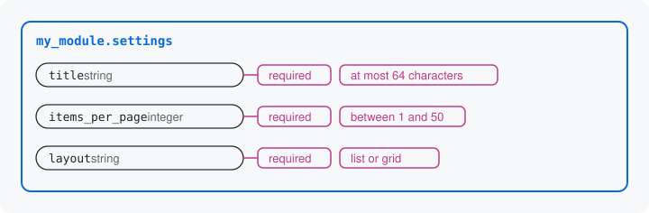

# Rules on a key

A rule says what values a key allows. A key can be required, a text can
have a maximum length, a number can have a range, and a value can be
held to a list of choices. Rules are written in the key's schema, and
the module checks them with Drupal's validation constraints: the same
`Length`, `Range` and `Choice` that entity fields and config schema
already use.



## Adding rules

A rule is a call on the key's schema, before the schema is handed to
`add()`. The three keys of your module's settings that carry rules:

```php
$inputs->add('title', Schema::string()
  ->title(t('Title'))
  ->default('Latest content')
  ->maxLength(64)
  ->required());

$inputs->add('items_per_page', Schema::integer()
  ->title(t('Items per page'))
  ->default(10)
  ->minimum(1)
  ->maximum(50)
  ->required());

$inputs->add('layout', Schema::options([
  'list' => t('List'),
  'grid' => t('Grid'),
])
  ->title(t('Layout'))
  ->default('list')
  ->required());
```

- `required()`: the key must hold a value. `FALSE`, `0` and an
  empty list count as a value; only nothing and the empty string do
  not. `show_author` and `notify_email` are not marked, so a caller
  may clear them. A key is required only when its schema says
  `required()`.
- `maxLength(64)`: the most characters a text may have. `minLength()`
  is the fewest.
- `minimum(1)` and `maximum(50)`: the lowest and highest number.
- `Schema::options([...])`: one of a list of values, each with a
  label. The array maps each allowed value to its label, and
  `type('string')` after it says what type the values are.
  `Schema::enum([...])` is a list of values with no labels.
- `pattern('^[a-z]+$')`: a text must match the regular expression.

Each of these is a JSON Schema keyword, and the module checks it with
Drupal's own validation constraint: `maxLength` with `Length`,
`minimum` and `maximum` with `Range`, a list of values with `Choice`.
Any other constraint registered with Drupal is a named check:
`check('drupal:NotBlank')`, with the constraint's options as a second
argument where it takes any. A rule is written once, on the key, and
nowhere else.

## What the form and the tool do with it

The form reads the rules to draw the fields: `layout` becomes a select
of List and Grid, `items_per_page` a number field from 1 to 50, and a
required key is marked required.

The JSON Schema states the same rules, for a tool or a client to read
before it sends anything (trimmed to two keys):

```json
"items_per_page": {
  "title": "Items per page",
  "type": "integer",
  "minimum": 1,
  "maximum": 50,
  "default": 10
},
"layout": {
  "title": "Layout",
  "type": "string",
  "oneOf": [
    {"const": "list", "title": "List"},
    {"const": "grid", "title": "Grid"}
  ],
  "default": "list"
},
"required": ["title", "items_per_page", "layout"]
```

A value that breaks a rule is refused at its key, in the rule's words.
Send `title` as `null`, and the tool refuses it with this object:

```json
{
  "path": "/title",
  "code": "required",
  "message": "Title is required."
}
```

The form says "Title is required." at the field. Send `layout` as
`table`, which is not one of the choices, and the message lists the
allowed values instead: "The value you selected is not a valid choice.
Choose list (List) or grid (Grid)."

Each place that asks for the values wraps a refusal in its own
envelope: the tool's `violations` list, the HTTP API's `errors` list,
the form's message at the field. The path, the code and the message
inside are the same everywhere, and later pages show only that inner
object.

Next: [Rules between keys](07-rules-between-keys.md)

Build it: [Declaring a resource or structure: required](../declaring-a-resource.md#required), then [Options and resolvers](../options.md) for lists of choices

See it in the examples: [Examples](../examples/index.md)
